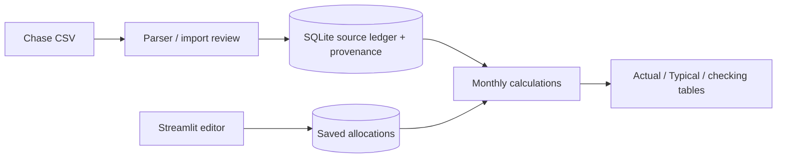

# Money tracker

A local, single-user Chase expense tracker. Import one checking account and two
separate card accounts, retain source facts, and correct personal cash flow using
persistent allocations. No bank credentials, sync, or external services are used.

## Local setup (macOS)

Python **3.11+** is required (verified with 3.12). From a clean clone:

```sh
git clone https://github.com/dhruv-dewan/money-dash.git
cd money-dash
git checkout feature/money-tracker-mvp
python3 -m venv .venv
source .venv/bin/activate
python -m pip install -r requirements-lock.txt
python -m pytest -q
python -m streamlit run app.py --server.address 127.0.0.1
```

Open **http://127.0.0.1:8501**. First run creates an empty SQLite database and
shows an import prompt. Usage telemetry is disabled in `.streamlit/config.toml`;
normal use binds to localhost. Stop with Ctrl-C. No seed data are loaded into your
ledger. The test suite creates only synthetic records in memory or temporary files.

`requirements.txt` pins the application dependency; `requirements-dev.txt` adds
pytest. `requirements-lock.txt` pins the full tested application/test environment.
When refreshing dependencies, deliberately regenerate the lock and rerun tests.
Browser smoke tests additionally require the optional Playwright dependency; see
[verification](#verification).

## First use and daily workflow

1. In **Import**, create `Checking` with kind checking, and separate card accounts
   such as `Card one` and `Card two`. Choose the correct account for each export.
   Account identity does not depend on filenames. Upload a CSV and click **Preview
   file**. Review source rows, proposed adds/reuses, and duplicate groups before
   **Commit import**. Import additional files sequentially.
2. In **Edit & review**, use the needs-review filter and large-amount ordering to
   inspect ambiguous credits/withdrawals. Payroll is conservatively recognized
   only for Stripe + payroll descriptions; credits over $10,000 require review.
   Confirm the purpose, category, one-off status, note, and optional budget month.
   Use **Quick edit · whole source** for one allocation, or add rows in the split editor. Enter signed dollar
   amounts; the total must equal the immutable source amount exactly.
3. For an August 26 $8,000 housing withdrawal, enter `-3000.00` Expense / Rent /
   budget month `2026-09`, `-2500.00` Deposit/pass-through/other exclusion with note
   `Refundable deposit`, and `-2500.00` of the same exclusion with note `Roommate
   advance`. Save. August Actual spending is $3,000; August checking outflow is
   $8,000; September Typical spending is $3,000. Mark the later roommate repayment
   as an exclusion with a note too. The app never infers housing amounts/months.
4. In **Month**, compare Actual and Typical, categories, review amounts, checking
   activity, and observed coverage. The detail filters do not change the labeled
   whole-month metrics. Select a source in either view and open **Edit & review**
   to edit it, including rent reassigned from another month. Save explicitly;
   changing form inputs/filters does not persist changes. Reset deletes the saved
   split and restores computed defaults.
5. For monthly re-imports, preview overlaps. An identical file on the same account
   is a no-op. A file hash on another account requires explicit confirmation.
   Fingerprint groups retain the maximum count observed, including suppressed
   occurrences. Choose **New / distinct** for a separate purchase that merely
   looks identical. Differing annotations/suppression without distinguishing
   metadata require explicit mapping; each occurrence can be reused once per file.
   Re-preview if a ledger change makes the preview stale.
6. In the editor, **Suppress confirmed duplicate** excludes a source from all
   reports without deleting facts/edits; **Restore** reverses it. Provenance lists
   each file/CSV row. If an import row was incorrectly reused, select it and
   **Separate import row into new source**. The new occurrence starts with defaults;
   the original retains its edits. Separation requires more than one provenance
   row on that source. Exact-file re-import remains a no-op after corrections.

## Storage, backup and restore

Default database: `data/money-tracker.sqlite3`, relative to the working directory.
Override using an absolute or home-relative path:

```sh
MONEY_TRACKER_DB="$HOME/Library/Application Support/money-tracker/ledger.sqlite3" \
  python -m streamlit run app.py --server.address 127.0.0.1
```

Stop the app before copying or restoring the database (including any SQLite
sidecars if present); alternatively use SQLite's backup API for a consistent live
backup. For example, after stopping the app:

```sh
mkdir -p backups
cp data/money-tracker.sqlite3 backups/ledger.sqlite3.bak
# Restore only with the app stopped:
cp backups/ledger.sqlite3.bak data/money-tracker.sqlite3
```

CSV files alone **cannot restore edits**, duplicate decisions, or budget months.
Keep private exports and backups outside Git. CSVs, local data, SQLite databases
and sidecars, screenshots, virtualenvs, and secrets are ignored. Only the synthetic
fixture directory is eligible for tracked CSVs.

## Reporting assumptions and limits

All arithmetic is integer cents. Card actual dates are purchase dates; checking
actual dates are posting dates. Typical uses allocation budget months and removes
one-offs across income, expenses, and refunds. Net spending is expenses minus
refunds and may be negative. Net is payroll + other income + standalone credits
minus net spending. Transfers and explicit exclusions do not count; Needs review
is disclosed separately and makes totals provisional. Recognized card Payment
and explicit Chase checking payment descriptions are excluded independently;
unrecognized payments need manual classification. Zero rows remain visible.

Observed date ranges are not proof of complete coverage. Months before July 2026
are stored but not offered for reporting. Budget-only months appear in the picker.
Current month is month-to-date. Dates/descriptions changed by the bank, and
indistinguishable purchases across partial exports, cannot be inferred reliably;
review or separate occurrences manually. A large payroll review cutoff is a
conservative fixed heuristic, not employer-specific anomaly detection.

This is a localhost, single-user MVP. No authentication, account balances, automatic
payment linking, budgeting targets, bank sync, other-bank parsers, or deployment
hardening. SQLite stores sensitive financial data unencrypted; protect the local
machine and backups. No real exports were used to develop or test this app.

## Architecture

See [ARCHITECTURE.md](ARCHITECTURE.md) for schema, invariants and extension points.

| File | Responsibility |
| --- | --- |
| `app.py` | Import, month, editor/review UI and explicit actions |
| `money_tracker/chase.py` | `parse`: strict CSV, dates, exact Decimal-to-cents, fingerprints |
| `money_tracker/imports.py` | `preview`, `commit`: provenance-aware occurrence matching and atomic imports |
| `money_tracker/db.py` | Versioned schema, immutable sources, split save/reset, suppression, separation |
| `money_tracker/ledger.py` | `default`, `validate`, `report`, `checking`: classifications and totals |
| `tests/test_mvp.py` | Synthetic parser, import, persistence and reporting acceptance tests |
| `tests/test_ui.py` | Streamlit editor and month rerender/restart checks |



## Verification

```sh
python -m pytest -q
```

Tests cover both schemas, invalid input rollback, multiplicities in both orders,
independent accounts, ambiguous mapping, metadata evidence, suppression, separation,
stale previews, exact split validation/reset, one-offs, refunds, payment legs,
cross-month purchase/posting dates, budget-only months, and the housing scenario.
UI tests use Streamlit's AppTest; real browser upload/edit/restart validation is
recorded in `VERIFICATION.md` with the commands and results actually observed.

Optional browser smoke test (uses a disposable synthetic database and port 8517):

```sh
python -m pip install playwright==1.56.0
python -m playwright install chromium
python tests/browser_smoke.py
```

If Chromium is already installed, set `PLAYWRIGHT_CHROMIUM_EXECUTABLE` to its path
instead of downloading a browser.
